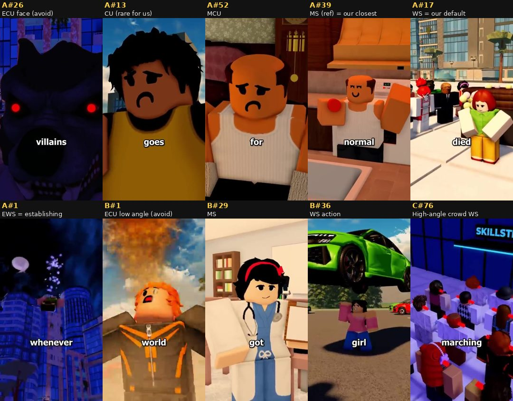
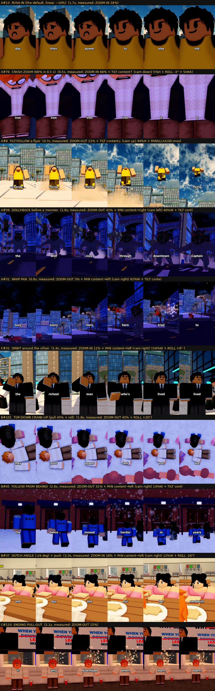
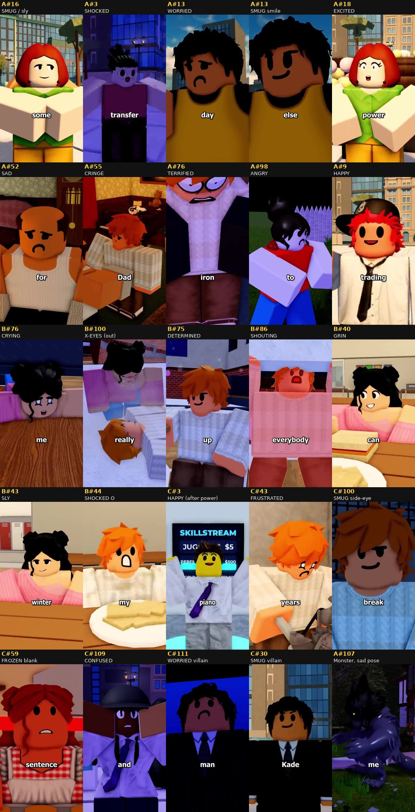
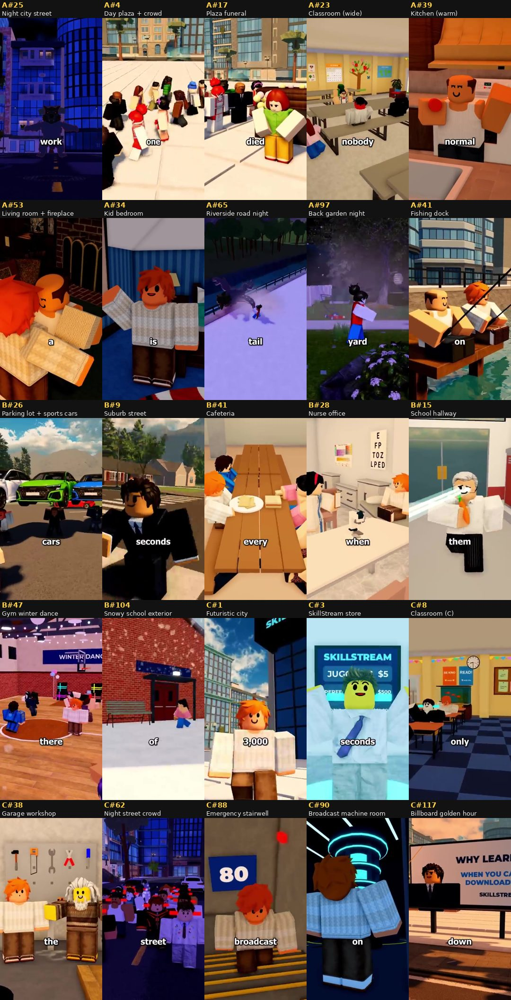
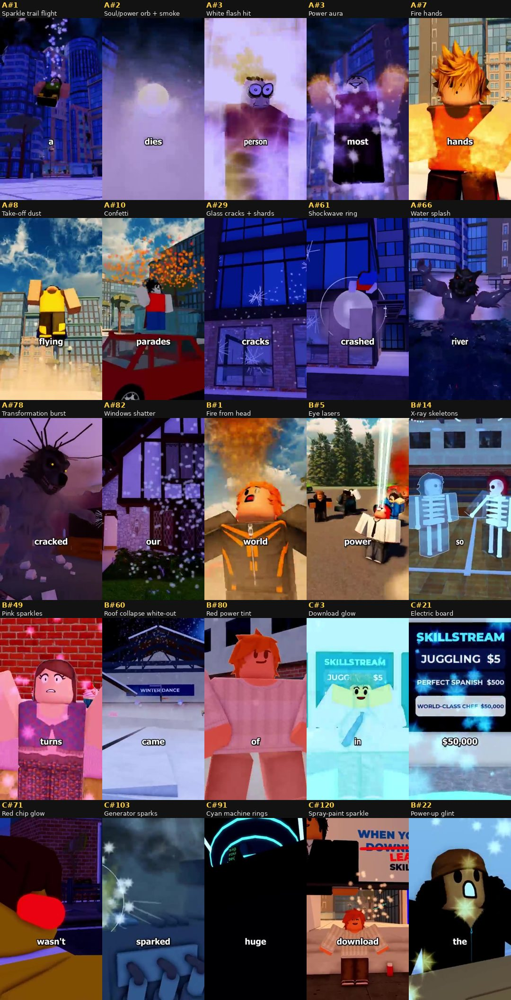

# 01 · Style Bible: how the 3 reference videos are made

This file is for the AI that builds the videos in Roblox Studio. It explains how the three reference
videos are put together, using numbers measured by code wherever possible. The shot-by-shot evidence is in
`02-…`, `03-…` and `04-…`; raw measurements are in `data/`.

| Code | Reference video | Length | Shots | Words |
|---|---|---|---|---|
| **A** | *Superpowers Transfer* (powers go to the person you love most → the villain was my dad) | 2:29 | 107 | 605 |
| **B** | *Peanuts* (your power = last thing you ate → I'm allergic to peanuts) | 2:22 | 107 | 583 |
| **C** | *Skill Downloads* (download any skill → the upgrade is a leash) | 2:29 | 120 | 555 |

**How this was measured:** every frame was extracted (13,188 frames: 4,474 + 4,252 + 4,462, at 360×640 and 30 fps).
Code found the shot cuts and measured the camera motion between every pair of frames (zoom, pan, tilt, roll, shake, parallax).
OCR read the one-word burned-in captions to rebuild each script with word timings.
Then the start, middle and end frames of all 334 shots (about 1,000 frames) plus filmstrips of the moving shots were checked by eye.

---

## 1. The format in one paragraph

Each video is a 9:16 vertical story of about 2.5 minutes. It opens with **"In my world, …"** plus a one-line rule for that world, and is
told in the first person by a kid. The voiceover is very fast (about 240 words per minute) and never pauses, with a music bed underneath the whole time.
Captions are **one word at a time** in the middle of the frame. A new shot comes **every 1.3 s** on average, and **almost every shot slowly
pushes in**. Characters are blocky Roblox avatars with **classic 2D faces that change on every emotional beat**. The sets are
**realistic Roblox maps** (city, school, home, parking lot, snow) with modern lighting, and a **visual effect lands on every power moment**.
Each story plants 2–3 props early (poster, EpiPen, bandages, billboard) and **pays them off at the end** with an insert shot.

---

## 2. The numbers

| Metric | A | B | C | **All** |
|---|---|---|---|---|
| Shots | 107 | 107 | 120 | **334** |
| Mean shot length | 1.39 s | 1.32 s | 1.24 s | **1.32 s** |
| Median / p10 / p90 | 1.33 / 0.70 / 2.30 | 1.30 / 0.55 / 2.10 | 1.19 / 0.53 / 2.10 | ≈1.3 / 0.6 / 2.2 s |
| Longest shot | 3.97 s | 2.97 s | 3.50 s | ≤ 4 s |
| Speech rate | 243 wpm | 247 wpm | 224 wpm | **≈ 240 wpm (4 words/s)** |
| Words per shot (median) | 6 | 5 | 5 | **5–6** |
| Cuts within ±0.1 s of a word onset | 85 % | 83 % | 79 % | **≈ 82 %** |
| Silent gaps ≥ 0.25 s in the voiceover | 2 | 3 | 12 | almost none |

**Camera motion, measured by optical flow on every frame:**

| Move class | Share of shots | Details |
|---|---|---|
| **Slow push-in (zoom in)** | **64 %** | Median **+10 %** over the shot (p25 6.5 %, p75 16 %), about **8 % per second**. 66 % have a *linear* (constant) speed. The zoom is centred with **zero parallax**, so it is a lens/FOV zoom, not a camera move. |
| Dynamic 3D moves | 27 % | Following flyers, dolly-back from a monster, orbits, whips, fast pans, dutch rolls, shakes |
| Locked / static | 5 % | Deadpan comedy beats and quiet endings |
| Pull-out (zoom out) | 3 % | Endings and realisations (B's death scene, C's final shot) |

**Extra devices, from the visual check of all 334 shots:** dutch/roll angle on 66 shots (20 %), shake on 35 (10 %),
micro-cuts under 0.4 s on 17 (5 %), crash zooms on 8, whip/wipe transitions on 8, follow/track/dolly on 10, orbits on 3, crane on 1.

**Shot sizes (estimated by eye):**

| Size | Share | What it looks like in 9:16 |
|---|---|---|
| ECU (face fills the frame) | 3 % | face only, e.g. A#26 werewolf, B#1 |
| CU | 9 % | head and shoulders, head ≈ 50 % of frame height |
| MCU | 20 % | head to chest, head ≈ 35 % |
| MS | 37 % | head to waist/thigh, head ≈ 20–28 % |
| WS | 23 % | full body with floor, head ≤ 15 % |
| EWS | 1 % | establishing, avatar tiny |
| Inserts (object close-ups) | 5 % | poster, phone, cookie note, clock, price board |
| POV / sky transitions | 1 % | x-ray POV, sky whip |

**About 1 in 3 character shots (34 %) are tight face shots (ECU/CU/MCU).** This is why the references feel "too close".
Our version changes this (see §10).

Angles: low angle on 22 shots (heroes, threats, power), high or top-down on 17 (crowds, victims, the fallen, endings),
over-the-shoulder on 14 (conversations, TV watching), from behind on 7 (following, walking into a new place).

---

## 3. Story shape → visual shape

All three videos follow the same skeleton. Timings are from the references.

| Beat | Time | What the picture does | Examples |
|---|---|---|---|
| **1. Hook + rule** | 0–5 s | The craziest image first, with no setup: a big VFX moment in a single moving shot | A: hero dives from the night sky, dies, orb rises. B: kid with fire erupting from his head. C: walking through a futuristic city into a "download" glow |
| **2. Rule examples** | 5–30 s | 4–8 one-shot gags, one image per example, each with its own mini-location | A: speed / fire / flying / cereal box. B: coffee speed, hot-sauce fire, carrot x-ray. C: piano, karate, surgery, jet |
| **3. "But me…"** | ~10–35 s | The narrator is the exception: sad or frustrated face, ordinary room | B#27 allergic, C#10 never downloaded |
| **4. Cast + planted clues** | 30–65 s | Each supporting character gets 2–4 shots. **Clues get insert shots** | A: bandaged hands, truck scratches. B: EpiPen in pocket. C: billboard slogan, grandpa's skills |
| **5. Inciting event via a screen** | ~50–70 s | TV, news or broadcast inside the world carries the exposition | A: "BREAKING NEWS – Captain Valor". C: "SKILLSTREAM LIVE · DORIAN" |
| **6. Escalation / disaster** | 70–110 s | Darker lighting, more shakes, dutch angles, crash zooms, crowds | A: TV fight then transformation. B: roof collapse. C: frozen city |
| **7. Hero move = pay-off** | 95–130 s | Inserts of the planted props come back; the hero uses them | A: scratches, bandages, hug flashback. B: cookie, EpiPen lost. C: picks the lock, breaks the generator |
| **8. Ending** | last 10–15 s | Slower shots (2–2.5 s), a final **reveal prop**, ending on a pull-out, a lock or a gentle orbit | A: hero lowers his fists. B: cookie + note on the bench. C: spray-painted billboard, pull-out |

**Text props inside the world are a signature device.** Posters, cereal boxes, TV lower-thirds, price boards, billboards,
phone screens, clocks and handwritten notes do the exposition, so the viewer *reads* the story inside the picture.

---

## 4. Camera grammar

### 4.1 The default shot: slow linear push-in
- Every shot that has no other reason to move gets a **constant-speed zoom in of 6–16 %** (median 10 %) across its
  1–2 s, centred on the frame. No ease, no parallax: a **pure FOV/zoom**.
- **Why:** Roblox avatars are stiff and faces are flat decals. A constant slow zoom keeps every frame alive and keeps retention
  up, and it makes static poses feel like a live camera. Cutting every 1.3 s between push-ins gives an unbroken forward feeling.
- In Roblox: `CineCam move="pushin", amount=0.10` (FOV 70 → 65 over the shot).

### 4.2 Locked shots (5 %)
- Used for **deadpan comedy** ("it went to his golden retriever" is set up on a locked MCU of the scheming wife, A#16–17),
  for **micro-cuts**, and for the **final quiet beat** (A#105–106: the hero and the werewolf-kid, no motion).
- **Why:** stillness after constant motion reads as "something is wrong / listen now".

### 4.3 Pull-out / zoom out (3 %)
- Reserved for **realisation and ending**: B#101 (top-down crane-up over the two kids in the snow while the narrator says the
  title line), C#120 (final reveal under the billboard, −15 %).
- **Why:** pulling away = the story letting go of the character / showing the full picture.

### 4.4 Slow orbit / arc (rare in the references, use more)
- C#31: the camera circles Dorian while the narration calls him "the richest man who ever lived". B#105: a slow arc around Chloe at the memorial bench.
- **Why:** an orbit gives a character status (power, importance) or makes a moment feel ceremonial.

### 4.5 Moving 3D camera (follow / dolly / tilt / crane)
- **Tilt-follow a flyer**: A#1 (from the sky down to the landing), A#8 (take-off up into the clouds), A#60, A#97.
- **Dolly-back before a monster**: A#28 and A#59 (the werewolf walks at the camera, low angle, the camera retreats, dust at its feet).
- **Follow from behind** into a new place: B#45 (walking into the dance through the snow), C#75 (following the crowd).
- **Tracking back** in front of a walking character: C#1, B#9.
- **Crane-up top-down** for the fallen: B#101.
- **Why:** real 3D moves are saved for **motion moments** (flying, charging, arriving). Everything else uses the cheaper zoom.

### 4.6 Crash zoom (8 shots)
- A 30–90 % zoom in 0.5–3 s on the **biggest shocks**: A#76 (the kid sees his hands turning to iron), B#77 (he eats the
  cookie, 93 %), B#85 (he runs under the roof), C#46, C#103.
- **Why:** it is the visual "gasp". Keep it rare or it stops working.

### 4.7 Whip pan / wipe (8 shots)
- A#20 skyline whip following the flying dog, A#31, A#42 (a stone pillar wipes across the frame), B#52 (a red door wipe), C#77.
- **Why:** a fast transition between places, or to follow something too fast to see.

### 4.8 Dutch angle and roll (20 % of shots)
- Usually 4–15°, up to 26° (B#37). The roll often drifts *during* the push.
- Used in tension, chaos, comedy panic and the "dizzy" love scenes in B. **Not** used in calm establishing shots.

### 4.9 Shake (10 %)
- Impacts (landing, crash, punch), monster footsteps, explosions, the roof collapse. Short and decaying.

### 4.10 Cutting rules
- **Cut on the word that introduces the new image** (82 % of cuts land within ±0.1 s of a word onset).
- **One idea per shot, 5–6 words per shot.**
- **Micro-cuts** (0.13–0.4 s) are punctuation: they flash a new angle on a single word ("Valor", "screaming", "anymore").
- Shots get longer (2–2.5 s) in the last 15 s.

---

## 5. Characters and avatars

**Rig and look.** Blocky R6-style avatars (or R15 with a blocky body) wearing **classic 2D face decals**. No dynamic heads.
Outfits are simple, flat and saturated so each character reads as one colour block on a phone.

**The recurring narrator** is the same in all three videos: **orange messy hair, cream knit sweater, brown pants** (blue sweater in some scenes).
He works as the channel's mascot, so keep one fixed narrator look.

**Supporting cast = one silhouette + one colour each:** Dad (bald, white tank top), Chloe (pink off-shoulder top,
jeans, two hair buns), Dorian (black suit, curly hair), Grandpa (wild white hair, brown vest), Mom (red bun, gingham apron),
Captain Valor (red/blue suit), the news reporter (purple earmuffs, tie). **Villains** are either a big custom mesh (the iron werewolf with
glowing eyes) or a smug man in a suit.

**Expressions are face swaps**, often **inside one shot** (A#13: worried → smug on the same line, C#3: surprised → happy at the
moment of the download). The faces used: smug/sly, shocked "O", worried, sad, excited, cringe, terrified, angry, happy,
crying, X-eyes (passed out), determined, shouting, grin, frustrated, frozen/blank, confused.

**Animations seen:** idle, walk, run (with dust), arms up (cheer/shock), arms out (receiving power), pointing,
hugging, patting a head, eating (hand to mouth), karate chop, lifting a car or beam over the head, holding up a roof,
crawling, collapsing, lying on the floor, kneeling in the snow, superhero flying pose, juggling, playing piano, crowds walking or marching in sync.

**Crowds:** 20–50 extra avatars for "everyone" shots (A#4 plaza, B#26 kids lifting cars, C#62–76 the frozen and marching city).

**Placement in a 9:16 frame:** the subject is centred horizontally almost every time, with the eyes in the **upper third**. Two-shots stack
one character in front and one behind (over-the-shoulder) rather than side by side, because the frame is narrow.

---

## 6. Locations and set dressing

Every location is a **realistic Roblox map built from real assets**: modern buildings, cars, street furniture and furniture
at correct human scale. No empty baseplates.

| Video | Locations |
|---|---|
| A | night downtown (blue-lit glass towers, wide streets, crosswalks), day plaza with tan-brick buildings and palm trees, funeral on the plaza, kitchen (warm wood, stove), living room (fireplace, grandfather clock, red curtains, TV), kid's bedroom (striped wallpaper, poster above the bed), back garden at night (tudor house, lanterns, flower beds, picket fence), riverside road with railing, wooden fishing dock |
| B | parking lot with sports cars and pine trees, suburban street (brick houses, mountains behind), school cafeteria (long wooden tables), nurse's office (eye chart), school hallway (lockers), gym decorated for the winter dance (banner, string lights, paper lanterns, cupcake table, balloons), snowy school exterior at night (bench, fire truck) |
| C | futuristic city (glass towers with cyan neon trim, SkillStream signage), SkillStream store (glowing download pads, price boards), classroom (yellow walls, checker floor, posters), garage workshop (pegboard of tools, engine), kitchen at night (digital wall clock), night street packed with frozen people, HQ plaza with a giant broadcast screen, back alley with a keypad door and a rusty service door, concrete emergency stairwell ("80"), broadcast machine room (cyan ring machine, servers, generator, wall fan), golden-hour street with billboards |

**Lighting:** a modern shadowed look (Future lighting style) with bloom, saturated colour, soft background blur and realistic cloud skyboxes.
Mood by time of day: **sunny day** for the "normal world", **blue/purple night** for danger, **snowy night** for drama, **golden hour** for the ending (C).

---

## 7. VFX catalogue (what, when, why)

| Effect | Where | Used for |
|---|---|---|
| Glowing neon **orb** + sparkle trail | A#2, A#86 | A power/soul leaving one body and travelling to another |
| **White flash** frame | A#3, C#21 | The instant a power is received; also a transition |
| **Aura** (glow + sparkles around a body) | A#3 | Power active |
| **Sparkle trail** behind a flyer | A#1, A#5, A#60 | Flying heroes |
| **Fire** from the head or hands | B#1, B#11, A#7 | Fire powers (hot sauce, fire hands) |
| **Dust burst** | A#8, B#3, B#5, C#5 | Take-off, landing, impact, karate chop |
| **Confetti** | A#10 | Parades, celebration |
| **Glass cracks + shards**, windows shattering | A#29, A#82 | A howl or explosion's reach |
| **Shockwave ring** | A#61–62, C#101 | Impacts |
| **Water splash** + foam | A#66–67 | Thrown into the river |
| **Transformation burst** (dust, debris, growth) | A#78 | Becoming the monster |
| **Glowing eyes** (red/yellow) | A#26, A#79 | Monster or villain identity |
| **Eye lasers** (beams) | B#5 | Laser power |
| **X-ray skeleton POV** | B#14, B#16 | See-through-walls power |
| **Colour tint on a body** (pink, red) | B#49–51, B#78–86 | Food powers (pink cupcakes, peanut strength) |
| **Indoor snow + roof collapse white-out** | B#59–62 | Disaster |
| **Download glow** (cyan wash over a body) | C#3, C#17, C#24 | Getting a skill |
| **Red chip glow** on every head | C#58–76 | Mind control |
| **Electric arcs / sparks / smoke** | C#103 | Machine destroyed |
| **Snow** (outdoor) | B#45, B#89–105 | Mood and weather |

---

## 8. Text and graphics

- **Captions:** one word at a time, lowercase as spoken (names capitalised), no punctuation. Bold rounded sans
  (Verdana Bold / Montserrat ExtraBold look), white fill, thin black outline and a soft drop shadow. Centred horizontally, with the
  baseline at about **68 % of the frame height**, letter height about **4 % of the frame height**. Each word appears exactly on its audio onset.
- **No other overlays**: no emojis, no arrows, no progress bars. All other text lives inside the world (signs, TVs, notes).

---

## 9. Audio

- The voiceover runs **without stopping** (almost no pause longer than 0.25 s): fast, clear, a kid or teen narrator, one reading.
- A **music bed** plays for the whole video under the voice (the noise floor never drops to silence).
- The edit follows the voice, not the music: cuts sit on word onsets.

---

## 10. Our version: what changes (owner's rules and improvements)

1. **Avatar a little farther from the camera (the main change).**
   - Default shot = **WS or MWS**: full body or knees up, with the **head at 12–22 % of frame height**.
   - **MS** (waist up, head ≈ 28 %) only for dialogue and reactions.
   - **CU** (head ≈ 45–50 %) at most **1–3 times per video**, only on the biggest emotional beats. **No ECU on faces.**
   - Target mix per video: WS/EWS 40 %, MWS 30 %, MS 20 %, CU ≤ 5 %, inserts 5 %. The references are about 34 % tight face shots; ours should be about 5 %.
   - A face is still readable on a phone at 12 % (about 230 px tall on a 1920 px screen), so nothing is lost.
2. **Build each location first, so it looks real.** Every new location gets an **establishing shot (EWS/WS, 1.5–2.5 s)**
   before any closer shot. Sets are built from **real Roblox Creator Store items** (buildings, cars, furniture, street props)
   at true scale. The reference photo for each location goes in the production doc.
3. **Same camera vocabulary, used on purpose.** Every shot names exactly one move: **LOCK · PUSH-IN · PULL-OUT ·
   SLOW ORBIT · MOVE (track/dolly/crane/pan/tilt) · CRASH ZOOM**, plus optional DUTCH and SHAKE, and every move has a stated reason.
   - Push-in amount scales with shot size: WS 5–8 %, MWS 8–10 %, MS 10–12 % (wider shots need less zoom to feel alive).
   - Slow orbit (15–30° over 2–4 s) on reveals, power moments and villain status. More often than the references, because the
     wider framing shows the 3D set off.
   - Crash zoom on 3–5 shocks per video at most.
   - The final shot is a pull-out or a lock.
4. **Rhythm stays the same:** about 5 words per shot and cuts on word onsets. Average shot length can rise to 1.4–1.6 s, because wider frames
   hold more to read. Establishing shots are 1.5–2.5 s.
5. **Clues get inserts.** Each planted prop gets a close insert when it is planted and again when it pays off.
6. **Continuity.** The same outfit within a scene, the 180° rule in conversations, eyelines that match, and the narrator's mascot look in every video.
7. **Exposition goes through screens and signs.** TV news, phones, clocks and billboards are built as real in-world GUI props.

---

## 11. Checklist the AI must pass for every shot

- [ ] Location built before the shot, with an establishing shot the first time we see it
- [ ] Shot size respects the distance rule (head ≤ 22 % unless the shot is marked MS or CU)
- [ ] One camera move named, with amount, easing and reason
- [ ] Face decal set for the beat (swap it inside the shot if the line turns)
- [ ] Animation or pose set (nobody stands in a T-pose)
- [ ] VFX on every power or impact moment
- [ ] Cut lands on the first word of the shot's line
